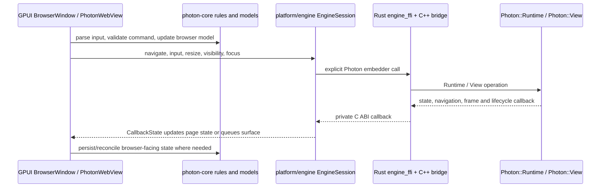

# Architecture

Photon has one Rust browser shell and one explicit Ladybird embedder boundary.
Browser rules and persistent browser models live in `photon-core`; GPUI views
and live window/tab coordination live in `photon-shell`; Ladybird remains behind
the Engine embedder API. Platform adapters own window integration and page
surfaces.

macOS is Photon's primary development platform. Linux support is experimental:
Ubuntu 24.04 CI validates workspace checks and tests, but the current revision
has not had a complete Engine build or interactive browser run. Windows
adapters are also present, but native Engine builds remain experimental under
Ladybird.

## Workspace map

```text
photon-app ── photon-shell ── photon-core
                    │             ├── address/search rules (omnibox)
                    │             ├── browser commands and state models
                    │             └── tab-sleep policy
                    ├── photon-storage
                    ├── photon-performance
                    ├── photon-brand
                    ├── gpui-motion
                    └── target adapters

photon-ffi ── photon-core         # independent C ABI for browser-model clients
photon-cli                         # setup, build, run and dependency workflows
photon-presentation-broker ── photon-presentation-ipc  # macOS presentation transport
```

The small omnibox and tab-sleep crates were folded into `photon-core` because
they are browser rules with no independent runtime boundary. GPUI shortcut and
haptic helpers were folded into `photon-shell` because they only adapt the
shell's actions and controls. `photon-performance`, `photon-storage`, and
`photon-brand` remain separate because each has a cohesive owner and useful
consumers beyond an individual view.

`photon-core` stays independent of GPUI, native handles, and Ladybird types. It
owns address/search resolution, browser commands, serializable state and
settings, history/session models, and browser policies. The live GPUI browser
window still coordinates windows, tabs, and view entities in
`platform/ui/window/`; the page-specific `BrowserState` is a small model, not
the complete live browser session.

## Browser and Engine state flow



The `BrowserWindow` is the GPUI coordinator: it owns window-level lifecycle,
tab ordering, transient chrome, and the shared runtime handle. Each
`PhotonWebView` owns one `EngineSession` and one page state. The Engine callback
adapter translates complete page snapshots into `photon_core::BrowserState`
and `EngineEvent`; callbacks schedule GPUI entity updates rather than mutating
views from Engine threads. Persisted windows and tabs use the framework-free
`photon_core::Session`, `WindowSession`, and `SessionTab` models, with file I/O
through `photon-storage`.

## Which “Photon API”

There are three distinct interfaces. Call them by owner so the word “API” does
not hide which boundary is meant.

| Interface | Source | Consumer and contract |
| --- | --- | --- |
| **Photon Engine embedder API** | [`PhotonEmbedder.h`](../Engine/Libraries/LibPhotonEmbedder/include/LibPhotonEmbedder/PhotonEmbedder.h) | Public C++ `Photon::Runtime`, `Photon::View`, callbacks, and engine operations. This is the only shell-to-Ladybird contract. |
| **Shell bridge ABI** | [`PhotonEmbedderBridge.h/.cpp`](../native/embedder/PhotonEmbedderBridge.h) and Rust declarations in [`engine_ffi.rs`](../crates/photon-shell/src/platform/engine_ffi.rs) | Private C ABI used to adapt the C++ embedder API to Rust. Keep pointer/string/layout adaptation here; it is not a second public browser API. |
| **Browser model C ABI** | [`photon_ffi.h`](../crates/photon-ffi/include/photon_ffi.h), implemented in [`api.rs`](../crates/photon-ffi/src/api.rs) | Separate static-library API for native clients that need address resolution and a lightweight browser-state model. It does not start Ladybird and is not used by the desktop shell. |

BrowserBench hooks live in the separate Engine
[`PhotonAutomation.h`](../Engine/Libraries/LibPhotonEmbedder/include/LibPhotonEmbedder/PhotonAutomation.h)
API. Ordinary shell code must not call arbitrary Engine implementation
classes, pass Ladybird objects into views, or expose page pixel buffers to
shared UI code.

## Shared shell and target adapters

`crates/photon-shell/src/platform/ui/` contains the GPUI browser chrome,
window coordinator, pages, and `PhotonWebView` for macOS, Linux, and Windows.
`platform/engine/` contains the shared Engine runtime/session adapter, callback
state, and navigation timing. The Rust declaration of the bridge C ABI is in
`platform/engine_ffi.rs`; target selection and shared contracts live in
`platform/mod.rs`.

| Target | Window/system adapter | Page presentation |
| --- | --- | --- |
| macOS | `platform/macos/`: AppKit view hosting and controls, display and visibility observers, clipboard, reduced motion, menus, and default-browser calls | `platform/macos/presentation.rs` handles XPC descriptors, IOSurface leases and Metal completion; `renderer.rs` gives GPUI-CE an external Metal surface. |
| Linux | `platform/linux/`: client-side window controls and Linux system-service adapter points | `renderer.rs` selects the CPU-frame adapter. Engine callbacks are pumped on the UI event loop. |
| Windows | `platform/windows/`: client-side window controls and Windows system-service adapter points | `renderer.rs` selects the CPU-frame adapter. Engine callbacks are pumped on the UI event loop. |

The shell only passes the opaque `PresentedSurface` contract into shared
`PhotonWebView`. macOS imports external Metal surfaces without copying full
frames. Linux and Windows currently copy the Engine's BGRA fallback frame at
the platform renderer boundary, convert it to a GPUI image, and let GPUI upload
it. This establishes the same UI and Engine-session path on those targets while
leaving room to add DMA-BUF or DXGI surface import behind the same contract.
Native menu, default-browser, reduced-motion, and visibility integrations that
are still placeholders in Linux or Windows adapters should be implemented
there; they must not add target checks throughout `platform/ui/`.

The Rust Engine adapter calls only `Photon::Runtime` and `Photon::View` through
the bridge. macOS uses its run-loop presentation notifications. Linux and
Windows call `Runtime::pump()` from the shell event loop because the public
embedder API requires regular pumping on the thread that created the runtime.
The bridge and Engine library are linked by `photon-shell/build.rs`; AppKit
Objective-C++ helpers remain macOS-only. The CLI sets the helper directory and
runtime library path for each target.

## Code ownership

| Location | Owns |
| --- | --- |
| `crates/photon-core` | Framework-free browser commands, navigation state, history/session/settings models, omnibox policy, and tab-sleep policy. |
| `crates/photon-storage` | Profile paths, history/settings/session files, favicons and profile data operations. |
| `crates/photon-shell/src/platform/ui` | GPUI presentation, window/tab interaction, shared WebView input and browser chrome. |
| `crates/photon-shell/src/platform/engine` | Shared `EngineRuntime`, `EngineSession`, callbacks, and callback-to-model adaptation. |
| `crates/photon-shell/src/platform/<target>` | Native window/system behavior and renderer selection. |
| `crates/photon-shell/src/platform/engine_ffi.rs` | Rust declarations for the private bridge ABI. |
| `native/embedder` | Narrow C++ wrapper around the public `Photon::Runtime` and `Photon::View` API. |
| `crates/photon-ffi` | Public `photon_browser_*` C ABI over core's lightweight model. |
| `crates/photon-performance` | Performance samples, bounded timing history, formatting, and diagnostics UI. |
| `crates/photon-presentation-ipc` | macOS XPC presentation transport; it owns transport, not browser policy. |
| `crates/photon-presentation-broker` | macOS presentation broker executable. |
| `vendor/gpui-ce` | Generic GPUI-CE behavior. Photon-specific native behavior stays in Photon adapters. |

## Presentation lifecycle

On macOS, the Engine compositor writes into IOSurface-backed buffers and
signals the producer event. Photon imports a backing once, coalesces frame
notifications, installs the latest external surface, and releases retired
frame leases only after GPUI-CE reports that sampling is complete. Shutdown
stops new frames, waits for submitted GPU work, releases held frames, then
destroys the Engine view.

On Linux and Windows, the Engine calls the same frame callback with a transient
BGRA buffer. The target presentation adapter validates dimensions and stride,
copies and converts the bytes before returning from the callback, and queues an
opaque GPUI image. Replaced images need no Engine lease. This path is portable
and correct but performs a full-frame copy; native shared-texture adapters can
replace it without changing browser views or the Engine session API.

## Common edit points

| Change | Start here |
| --- | --- |
| Browser state, commands, address/search rules | [`photon-core/src/`](../crates/photon-core/src/lib.rs) |
| Persisted profile data | [`photon-storage/src/`](../crates/photon-storage/src/lib.rs) |
| Shared browser UI or tab behavior | [`platform/ui/`](../crates/photon-shell/src/platform/ui/mod.rs) |
| Shared Engine calls and callback translation | [`platform/engine/`](../crates/photon-shell/src/platform/engine/mod.rs) |
| Shell-to-Engine C ABI declarations or bridge | [`engine_ffi.rs`](../crates/photon-shell/src/platform/engine_ffi.rs), [`PhotonEmbedderBridge.cpp`](../native/embedder/PhotonEmbedderBridge.cpp), then the public [`PhotonEmbedder.h`](../Engine/Libraries/LibPhotonEmbedder/include/LibPhotonEmbedder/PhotonEmbedder.h) contract |
| Target window controls, menus, or system preferences | [`platform/<target>/`](../crates/photon-shell/src/platform/mod.rs) |
| Page surface import or GPUI rendering | [`platform/<target>/renderer.rs`](../crates/photon-shell/src/platform/linux/renderer.rs), plus the matching presentation adapter |
| Presentation transport | [`photon-presentation-ipc`](../crates/photon-presentation-ipc/src/lib.rs) and the macOS broker |
| Shared colors and style roles | [`theme.toml`](../crates/photon-shell/theme.toml) and [`platform/ui/theme.rs`](../crates/photon-shell/src/platform/ui/theme.rs) |
| Shared dimensions and type sizes | [`platform/ui/metrics.rs`](../crates/photon-shell/src/platform/ui/metrics.rs) |
| Exported browser model ABI | [`photon-ffi/include/photon_ffi.h`](../crates/photon-ffi/include/photon_ffi.h) and [`photon-ffi/src/api.rs`](../crates/photon-ffi/src/api.rs) |

Keep a crate only when it has an independent owner or a useful consumer outside
its current crate. Keep OS branches inside adapters, state rules in core, and
Ladybird behavior behind the explicit Engine embedder API.

See [tab layouts and the sidebar](Sidebar.md), [PhotonWebView](WebView.md),
[Photon pages](Pages.md), [profile and settings](Profile.md), [the omnibox](Omnibox.md),
[native GPU presentation](NativeGpuPresentation.md), [theme tokens](Theme.md),
and [upstream maintenance](Upstream.md).
