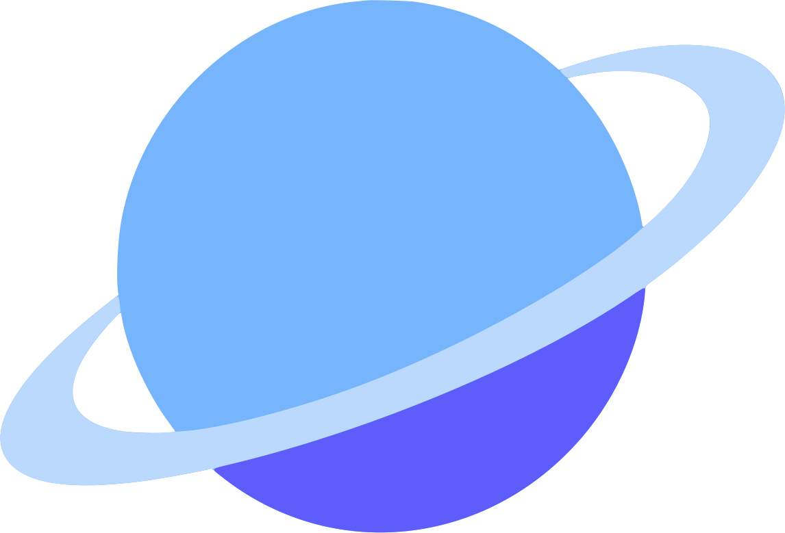
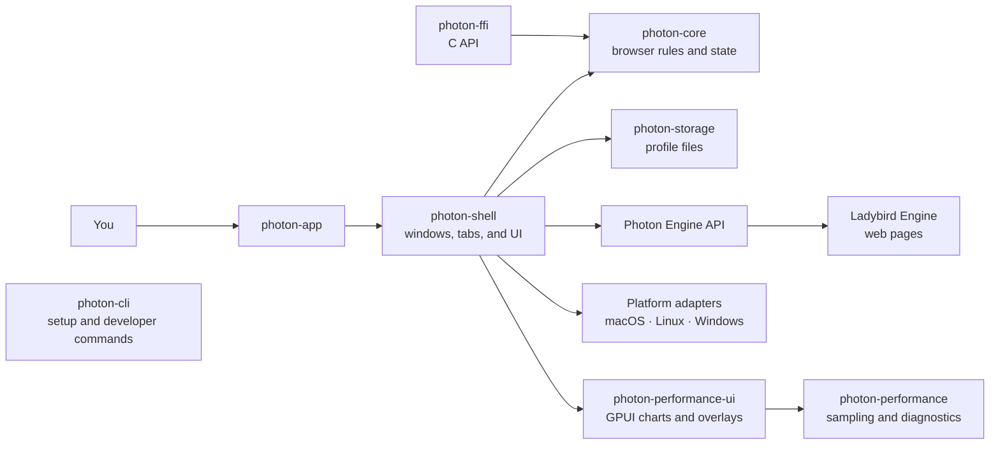

<p align="center"></p>

<h1 align="center">Photon</h1>

<p align="center"><strong>A browser built on <a href="https://ladybird.org">Ladybird</a>.</strong></p>

<p align="center">
  <a href="#run-from-source">Run from source</a> ·
  <a href="Documentation/Architecture.md">Architecture</a> ·
  <a href="Documentation/Roadmap.md">Roadmap</a> ·
  <a href="CONTRIBUTING.md">Contributing</a>
</p>


## Run from source

Install the platform prerequisites in [contributor setup](CONTRIBUTOR_SETUP.md) first.

```sh
git clone --recurse-submodules https://github.com/PhotonBrowser/photon.git
cd photon
```

On macOS, run `./photon setup --install-system-deps`; on Linux, install the
packages listed in [contributor setup](CONTRIBUTOR_SETUP.md), then run
`./photon setup`. Follow the platform-specific build and run guidance there
before launching Photon.

Setup installs or refreshes the `photon` command and `ph` alias in Cargo's bin directory. Make
sure `~/.cargo/bin` is on your `PATH` to use `photon` without the `./` prefix.

To work on the GPUI shell on Linux without setting up Ladybird Engine, clone
without submodules and use the UI-only path:

```sh
git clone https://github.com/PhotonBrowser/photon.git
cd photon
./photon setup --ui-only
photon run --ui
```

This opens the New Tab page and Photon-owned settings pages; web pages require
the full Engine setup.

## Develop Photon

Start with [contributor setup](CONTRIBUTOR_SETUP.md), then use the [build guide](Documentation/Building.md) and [architecture guide](Documentation/Architecture.md). See [contribution guidance](CONTRIBUTING.md) for pull requests and the [roadmap](Documentation/Roadmap.md) for planned work.



The shell connects the browser interface to framework-independent browser
rules, profile storage, and the Ladybird Engine. See the
[architecture guide](Documentation/Architecture.md) for component boundaries
and common change locations.

<details>
<summary>Rust crate guides</summary>

- [photon-app](crates/photon-app/README.md) · [photon-brand](crates/photon-brand/README.md) · [photon-cli](crates/photon-cli/README.md) · [photon-core](crates/photon-core/README.md)
- [photon-ffi](crates/photon-ffi/README.md) · [photon-performance](crates/photon-performance/README.md) · [photon-performance-ui](crates/photon-performance-ui/README.md)
- [photon-presentation-broker](crates/photon-presentation-broker/README.md) · [photon-presentation-ipc](crates/photon-presentation-ipc/README.md) · [photon-shell](crates/photon-shell/README.md)
- [photon-storage](crates/photon-storage/README.md) · [gpui-motion](crates/gpui-motion/README.md)

</details>

## Star History

<a href="https://www.star-history.com/?repos=photonbrowser%2Fphoton&type=date&legend=top-left">
 <picture>
   <source media="(prefers-color-scheme: dark)" srcset="https://api.star-history.com/chart?repos=photonbrowser/photon&type=date&theme=dark&legend=top-left" />
   <source media="(prefers-color-scheme: light)" srcset="https://api.star-history.com/chart?repos=photonbrowser/photon&type=date&legend=top-left" />
   
 </picture>
</a>
